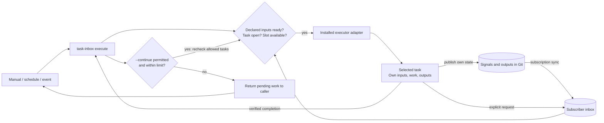

# task-inbox

A durable Git-backed inbox for task requests. Producers submit work; scripts,
services, or LLM-powered agents process pending requests in a loop and
acknowledge results. task-inbox coordinates concurrency, progress, and recovery
across processes or machines.

Use it with your existing workers and scheduler. `task-inbox execute` checks
conditions, admits and supervises a worker, and optionally continues to another
eligible task. An installed executor adapter supplies the agent or script.

## Task and caller design

A task declares the inbox kinds it handles, the signal types it reads and
publishes, and its readiness rule. It owns its business outputs and completion
evidence. It can send an explicit request to another inbox or publish its own
signals, without knowing which tasks consume its outputs or how they use them.
Task instructions do not detect Codex Cloud, a local machine, GitHub Actions,
or a hosted service. Required capabilities and domain targets belong to the
task; credentials, tools, placement and worker startup belong to the caller.



Subscriptions and execution allowlists are caller configuration. Producers do
not name subscribers in their signal declarations. A same-invocation chain and a
later scheduled or triggered run use the same readiness checks; each task gets
its own run ID, ownership, workspace and heartbeat. Notification persistence is
separate from delivery of a host-specific startup hint.

See the [execution and task interface contract](docs/task-execution.md) for
declarations, adapters, continuation, recovery and migration.

## Intended use cases

task-inbox is intended for Git-backed workflows run by scripts, services, or
LLM-powered agents, such as:

- **Inbox-driven work and handoffs:** Collect requests in a durable inbox,
  including while its worker is stopped or paused. A worker processes pending
  requests in a loop and acknowledges each result; other tasks can submit work
  and read those results.
- **LLM task execution:** Have an agent read Markdown task instructions and use
  its model and tools to perform the work, while task-inbox coordinates run
  ownership, progress, and accepted results. Your executor supplies the agent,
  LLM provider, and tools.
- **Recurring maintenance:** Run scheduled repository checks or report generation,
  keeping task instructions, accepted outputs, and execution history in Git.
- **Serialized shared work:** Let several producers submit requests to a task
  with one consumer, for example to coordinate updates to a shared report.
- **Work across processes or machines:** Use a shared task-data repository to
  coordinate concurrent runs, track progress, and retain checkpoints and evidence
  for recovery after an interruption.

These workflows use your executor's scheduling, worker startup, and recovery
integration. For concrete examples of inbox handoffs, concurrent callers, and
interrupted workers, see the [local end-to-end scenarios](docs/task-runtime-scenarios.md).

## Requirements

- Git and Python 3.10+ on Linux, macOS, or WSL.
- A task-data Git repository with authentication and Git author identity configured.
  The runtime needs permission to push updates to its task-data branch.

The runtime uses the Python standard library. No additional Python packages or
persistent service are required, and any Git host meeting the
[transport requirements](docs/task-runtime-adapters.md) can be used.

## Quick start

Clone this source repository and run the commands below from its root. Replace
`/path/to/task-data` with a separate clone of your task-data repository with an
`origin` remote. Create a Markdown file containing your task's instructions and
use its path in place of `/path/to/task.md`.

```sh
python3 bin/task-inbox --repo /path/to/task-data --operation-id setup init
python3 bin/task-inbox --repo /path/to/task-data --operation-id add-example \
  task add --id example --title 'Example task' --body-file /path/to/task.md
python3 bin/task-inbox --repo /path/to/task-data task list
```

You can customize task and output locations when registering tasks. See
[configuration and task management](docs/task-runtime.md).

## Send work to a task

Create a JSON object at `/path/to/request.json`, then send it to the task's inbox
and ask for a run:

```sh
python3 bin/task-inbox --repo /path/to/task-data --operation-id send-request-1 \
  io send --task example --message-id request-1 --kind work --payload-file /path/to/request.json
python3 bin/task-inbox --repo /path/to/task-data --operation-id wake-request-1 \
  io wake --task example --runner worker-1 --run-id run-1
```

When `wake` returns `action=start`, your executor uses the returned run, starting
with `run prepare`. Neither `wake` nor a Git push launches a worker. Reuse the
same operation ID when retrying an operation. See the [worker and message
workflow](docs/task-io.md#requests-and-startup) for execution, results, and finish.

Complete a reconciled request with `io complete`, reusing one operation ID for
retries. A run with a business completion contract can supply terminal evidence
with `run finish --completion-file`; use `run completion` to persist unknown
outcomes before reconciliation. See [progress and results](docs/task-io.md#progress-external-operations-and-results).

### One execution entrypoint

Register or edit tasks with `--interface-file` to declare their handled inbox
kinds, signal types and readiness. Then use the same entrypoint from any host:

```sh
python3 bin/task-inbox --repo /path/to/task-data execute --task example --check
python3 bin/task-inbox --repo /path/to/task-data --operation-id invocation-1 \
  execute --task example --runner worker-1 --executor /opt/workers/task-executor
python3 bin/task-inbox --repo /path/to/task-data --operation-id invocation-2 \
  execute --task example --task report --runner worker-1 \
  --executor /opt/workers/task-executor --continue --max-tasks 4
```

The default executes at most one eligible task. Continuation only selects from
the caller's ordered `--task` allowlist. `--check` never admits or launches a run.
Tasks without a declaration remain manual; `--force` explicitly requests the
first task once. Existing `io wake` and `run` commands remain available for
integrations managing individual lifecycle steps.

For **Codex Cloud schedules or local Codex sessions**, keep a short caller
bootstrap prompt that references the canonical procedure; give the admitted
worker its pinned task instructions and context. The current session needs an
installed worker adapter to use `execute` for launch. For **GitHub Actions**, the
workflow provisions that adapter and calls the same entrypoint; it also owns
startup hints and workflow-rerun identity. See [Codex prompts](docs/task-execution.md#codex-cloud-and-local-prompts)
and the [Actions workflow example](docs/task-execution.md#github-actions-caller),
including the compatibility procedure for an interactive worker without an adapter.

### Process inbox requests in a loop

Use the inbox to accept requests now and process them when a worker next runs.
`execute` manages the caller lifecycle. Integrations managing lifecycle primitives
themselves can use this equivalent loop; an LLM agent handles requests according
to the task's Markdown instructions:

1. Producers submit requests with `io send`. Requests remain pending until a
   worker acknowledges a result with `io complete`.
2. Your scheduler or controller calls `io wake`. On `action=start`, it prepares
   the returned run and starts the worker. On `busy` or `paused`, requests stay
   pending; on `idle`, there is no inbox work to start.
3. The worker reads requests with `io pending`, performs the requested work,
   verifies the outcome, and records each result with `io complete`. It fetches
   pending requests again after each acknowledgement, so requests arriving
   during execution are included in the loop.
4. Once the inbox is drained, the worker finishes with `run finish`. The
   controller checks the inbox again and wakes another run if needed. Each
   scheduled invocation also checks pending requests, so work arriving after
   the worker stops can be picked up on the next invocation.

Inbox consumers currently require `max_runners=1`; multiple producers can submit
requests concurrently. See the [worker and message workflow](docs/task-io.md#requests-and-startup)
for integration details.

## Portable distribution

The build command was renamed from `bin/build-task-runtime` to
`bin/build-task-inbox`. Update build scripts that use the old path.

Build a standalone executable or an editable source archive:

```sh
python3 bin/build-task-inbox --output /tmp/task-inbox.pyz
python3 bin/build-task-inbox --format source --output /tmp/task-inbox-source.tar.gz
```

Distributions include license notices and exclude task data and credentials.
Copied installations run independently of this repository. See
[distribution and customization](docs/task-runtime.md#independent-company-use-and-customization).

## Task signals

Runtime 2.12 adds optional typed task signals, configurable inbox subscriptions,
and inbox-based reconciliation. Publish, finish and task startup synchronize
current state from Git without a delivery ledger.
See [signals and migration](docs/task-signals.md); enable schema 10 only after
all deployed readers/writers are updated and existing runs have drained.

## Documentation

| Topic | Guide |
| --- | --- |
| Task setup, execution, and configuration | [Runtime guide](docs/task-runtime.md) |
| Task boundaries, interfaces and the execution entrypoint | [Execution guide](docs/task-execution.md) |
| Messages and worker integration | [Task I/O](docs/task-io.md) |
| Git transports and deployment checks | [Adapters](docs/task-runtime-adapters.md), [deployment](docs/task-runtime-deployment.md) |
| Recovery resources and cleanup | [Reports](docs/task-runtime-reports.md), [cleanup](docs/task-runtime-cleanup.md) |
| Interface changes and migration decisions | [Runtime 2.11 decisions](docs/task-runtime-slim.md) |
| Development, tests, and coverage | [Contributing](CONTRIBUTING.md) |
| Vulnerability reporting | [Security policy](SECURITY.md) |

For existing installations, check the [upgrade requirements](docs/task-io.md#run-streams)
before changing runtime versions. Runtime 2.11 upgrades to schema 9 only after
all existing runs have drained; update readers and writers together.

## License

[MIT](LICENSE). Source archives and zipapps include the license notice.
