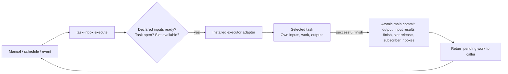
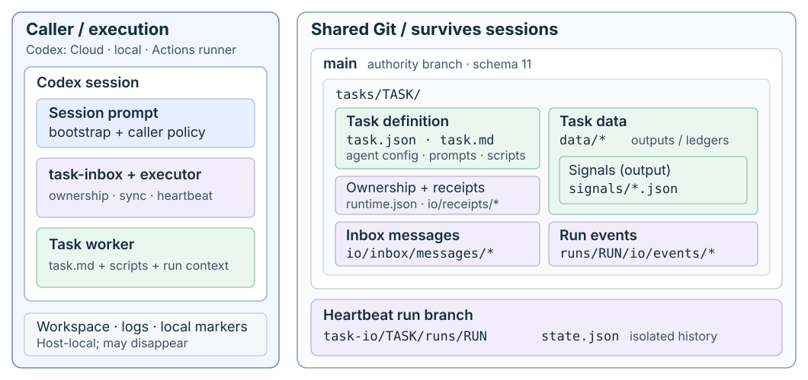

# task-inbox

A durable Git-backed inbox for task requests. Producers submit work; scripts,
services, or LLM-powered agents process pending requests in a loop and
acknowledge results. task-inbox coordinates concurrency, progress, and recovery
across processes or machines.

Use it with your existing workers and scheduler. `task-inbox execute` checks
conditions, admits and supervises one task per invocation. An installed executor adapter supplies the agent or script.

## Task and caller design

A task declares the inbox kinds it handles, the signal types it reads and
publishes, and its readiness rule. It owns its business outputs and completion
evidence. It can send an explicit request to another inbox or publish its own
signals, without knowing which tasks consume its outputs or how they use them.
Task instructions do not detect Codex Cloud, a local machine, GitHub Actions,
or a hosted service. Required capabilities and domain targets belong to the
task; credentials, tools, placement and worker startup belong to the caller.

### Execution flow



Subscriptions are caller configuration. Producers declare signal IDs and types,
without naming subscribers. task-inbox persists notifications; the host watches
inbox updates and starts each next task independently. Heartbeats stay on a
separate run stream and never merge their history into main.

See the [main inbox protocol](docs/task-main-inbox.md) for schema 11 adoption,
atomic finish, signal conditions and workspace behavior, and the
[execution contract](docs/task-execution.md) for adapters and recovery.

### Responsibility and storage map

Execution is caller-owned; task definitions and data live in shared Git.
The session prompt supplies bootstrap policy; `task.md` supplies business instructions.

[](docs/assets/task-inbox-structure.svg)

The SVG uses a fixed, compact layout; open it for a larger view. Boxes show
logical responsibilities: an adapter can use separate worker processes/sessions.
Other executors use the same Git storage contract.

The map shows schema 11, adopted explicitly with `io migrate` (see
[migration](docs/task-main-inbox.md#migration-and-host-integration)). `TASK`,
`RUN`, `MESSAGE` and `SIGNAL` are placeholders. Paths and branch names
show the default layout; task directories, `data_path`, the authority branch and
I/O namespace can be configured. Task definitions and signals are files on main,
alongside inbox messages, accepted receipts and run events. Heartbeat history
uses a separate run branch in the same repository.

| Responsibility | Authoritative data location in the default layout |
| --- | --- |
| Caller: host, actual model/tools, credentials and policy for subsequent invocations | Caller integration and installed executor profile; bootstrap references canonical instructions |
| Task: definition, worker prompt and preferred model/effort | `main:tasks/TASK/task.json`, `task.md`, task-owned agent configuration and linked prompts/scripts/runbooks |
| Task: permanent outputs and current output signals | `main:tasks/TASK/data/*`, including `data/signals/SIGNAL.json` |
| Runtime: inbox protocol, with requests submitted by producers | `main:tasks/TASK/io/inbox/messages/MESSAGE.json` |
| Runtime: immutable run events | `main:tasks/TASK/runs/RUN/io/events/` |
| Runtime: per-run heartbeat | Branch `task-io/TASK/runs/RUN`, containing `state.json` |
| Runtime: ownership and accepted receipts | `main:tasks/TASK/runtime.json` and `io/receipts/MESSAGE.json` |
| Caller routing and runtime coordination metadata | `main:.task-system/`, including signal subscriptions and operation receipts |

Before schema 11 migration, inboxes use `task-io/TASK/inbox` and run streams
also hold events and result candidates; see [legacy storage](docs/task-io.md#legacy-storage-before-schema-11).

Main remains the authority for ownership and accepted results. A heartbeat on a
run branch does not grant a slot. Work checkpoints use another runtime branch,
`task-runtime/TASK/RUN/work`; they do not replace accepted task data on main.
After finish, verified run I/O can be collected, with completed execution
metadata read from main history. See [storage and retention](docs/task-io.md#storage-and-ownership)
and [cleanup](docs/task-runtime-cleanup.md). Prompts use the
[caller/worker roles](docs/task-execution.md#codex-cloud-and-local-prompts);
business instructions remain independent of the chosen host and output consumers.

## Intended use cases

task-inbox is intended for Git-backed workflows run by scripts, services, or
LLM-powered agents, such as:

- **Inbox-driven work and handoffs:** Collect requests in a durable inbox,
  including while its worker is stopped or paused. A worker processes pending
  requests in a loop and acknowledges each result; other tasks can submit work
  and read those results.
- **LLM task execution:** Have an agent read Markdown task instructions and use
  its model and tools to perform the work, while task-inbox coordinates run
  ownership, progress, and accepted results. Your executor supplies the agent,
  LLM provider, and tools.
- **Recurring maintenance:** Run scheduled repository checks or report generation,
  keeping task instructions, accepted outputs, and execution history in Git.
- **Serialized shared work:** Let several producers submit requests to a task
  with one consumer, for example to coordinate updates to a shared report.
- **Work across processes or machines:** Use a shared task-data repository to
  coordinate concurrent runs, track progress, and retain checkpoints and evidence
  for recovery after an interruption.

These workflows use your executor's scheduling, worker startup, and recovery
integration. For concrete examples of inbox handoffs, concurrent callers, and
interrupted workers, see the [local end-to-end scenarios](docs/task-runtime-scenarios.md).

## Requirements

- Git and Python 3.10+ on Linux, macOS, or WSL.
- A task-data Git repository with authentication and Git author identity configured.
  The runtime needs permission to push updates to its task-data branch.

The runtime uses the Python standard library. No additional Python packages or
persistent service are required, and any Git host meeting the
[transport requirements](docs/task-runtime-adapters.md) can be used.

## Quick start

Clone this source repository and run the commands below from its root. Replace
`/path/to/task-data` with a separate clone of a new task-data repository with an
`origin` remote. Create a Markdown file containing your task's instructions and
use its path in place of `/path/to/task.md`.

```sh
python3 bin/task-inbox --repo /path/to/task-data --operation-id setup init
python3 bin/task-inbox --repo /path/to/task-data --operation-id setup-main-inbox \
  io migrate --confirm-writers-drained
python3 bin/task-inbox --repo /path/to/task-data --operation-id add-example \
  task add --id example --title 'Example task' --body-file /path/to/task.md
python3 bin/task-inbox --repo /path/to/task-data task list
```

The migration command enables schema 11 in this new repository, with no existing
writers or runs to drain. For an existing installation, follow the
[coordinated migration procedure](docs/task-main-inbox.md#migration-and-host-integration)
before confirming writer drain. You can customize task and output locations
when registering tasks. See
[configuration and task management](docs/task-runtime.md).

## Send work to a task

Create a JSON object at `/path/to/request.json`, then send it to the task's inbox
and ask for a run:

```sh
python3 bin/task-inbox --repo /path/to/task-data --operation-id send-request-1 \
  io send --task example --message-id request-1 --kind work --payload-file /path/to/request.json
python3 bin/task-inbox --repo /path/to/task-data --operation-id wake-request-1 \
  io wake --task example --runner worker-1 --run-id run-1
```

When `wake` returns `action=start`, your executor uses the returned run, starting
with `run prepare`. Neither `wake` nor a Git push launches a worker. Reuse the
same operation ID when retrying an operation. See the [worker and message
workflow](docs/task-io.md#requests-and-startup) for execution, results, and finish.

For schema 11, pass captured, verified input results to
`run finish --input-results-file` to accept them atomically with output, slot
release and subscriber notifications. `io complete` remains available for an
explicit mid-run acknowledgement; reuse one operation ID for retries. A run with
a business completion contract can supply terminal evidence
with `run finish --completion-file`; use `run completion` to persist unknown
outcomes before reconciliation. See [progress and results](docs/task-io.md#progress-external-operations-and-results).

### One execution entrypoint

Register or edit tasks with `--interface-file` to declare their handled inbox
kinds, signal types and readiness. Then use the same entrypoint from any host:

```sh
python3 bin/task-inbox --repo /path/to/task-data execute --task example --check
python3 bin/task-inbox --repo /path/to/task-data --operation-id invocation-1 \
  execute --task example --runner worker-1 --executor /opt/workers/task-executor
```

Execution admits at most one task. Each next task requires a separate caller invocation. `--check` never admits or launches a run.
Tasks without a declaration remain manual; `--force` explicitly requests the
first task once. Existing `io wake` and `run` commands remain available for
integrations managing individual lifecycle steps.

For **Codex Cloud schedules or local Codex sessions**, keep a short caller
bootstrap prompt that references the canonical procedure; give the admitted
worker its pinned task instructions and context. The current session needs an
installed worker adapter to use `execute` for launch. For **GitHub Actions**, the
workflow provisions that adapter and calls the same entrypoint; it also owns
startup hints and workflow-rerun identity. See [Codex prompts](docs/task-execution.md#codex-cloud-and-local-prompts)
and the [Actions workflow example](docs/task-execution.md#github-actions-caller),
including the compatibility procedure for an interactive worker without an adapter.

### Process inbox requests in a loop

Use the inbox to accept requests now and process them when a worker next runs.
`execute` manages the caller lifecycle. Integrations managing lifecycle primitives
themselves can use this equivalent loop; an LLM agent handles requests according
to the task's Markdown instructions:

1. Producers submit requests with `io send`. Requests remain pending until a
   worker explicitly records a verified result.
2. Your scheduler or controller calls `io wake`. On `action=start`, it prepares
   the returned run and starts the worker. On `busy` or `paused`, requests stay
   pending; on `idle`, there is no inbox work to start.
3. The worker reads requests with `io pending`, performs the requested work,
   verifies the outcome, and captures results for the messages it handled. Under
   schema 11 it can defer those results to finish; `io complete` accepts an
   individual result immediately. When fetching additions, exclude captured
   messages awaiting finish so they are not processed twice.
4. Once the captured batch is complete, the worker finishes with
   `run finish --input-results-file results.json` on schema 11. This accepts only
   the supplied results; later arrivals stay pending. The
   controller checks the inbox again and wakes another run if needed. Each
   scheduled invocation also checks pending requests, so work arriving after
   the worker stops can be picked up on the next invocation.

Inbox consumers currently require `max_runners=1`; multiple producers can submit
requests concurrently. See the [worker and message workflow](docs/task-io.md#requests-and-startup)
for integration details.

## Portable distribution

The build command was renamed from `bin/build-task-runtime` to
`bin/build-task-inbox`. Update build scripts that use the old path.

Build a standalone executable or an editable source archive:

```sh
python3 bin/build-task-inbox --output /tmp/task-inbox.pyz
python3 bin/build-task-inbox --format source --output /tmp/task-inbox-source.tar.gz
```

Distributions include license notices and exclude task data and credentials.
Copied installations run independently of this repository. See
[distribution and customization](docs/task-runtime.md#independent-company-use-and-customization).

## Task signals

Runtime 2.14 with schema 11 adds declared signal IDs, automatic revisions and
`change`/`run` subscriptions. Successful finish saves outputs and subscriber
messages in the same main commit; intermediate publication does not deliver
signals. See the [main inbox and signal protocol](docs/task-main-inbox.md) for
adoption and the [schema 10 signal guide](docs/task-signals.md) for legacy behavior.

## Documentation

| Topic | Guide |
| --- | --- |
| Task setup, execution, and configuration | [Runtime guide](docs/task-runtime.md) |
| Task boundaries, interfaces and the execution entrypoint | [Execution guide](docs/task-execution.md) |
| Messages and worker integration | [Task I/O](docs/task-io.md) |
| Main inboxes, atomic finish and signal contracts | [Main inbox protocol](docs/task-main-inbox.md) |
| Git transports and deployment checks | [Adapters](docs/task-runtime-adapters.md), [deployment](docs/task-runtime-deployment.md) |
| Recovery resources and cleanup | [Reports](docs/task-runtime-reports.md), [cleanup](docs/task-runtime-cleanup.md) |
| Interface changes and migration decisions | [Runtime 2.11 decisions](docs/task-runtime-slim.md) |
| Development, tests, and coverage | [Contributing](CONTRIBUTING.md) |
| Vulnerability reporting | [Security policy](SECURITY.md) |

For existing installations, follow the [schema 11 migration procedure](docs/task-main-inbox.md#migration-and-host-integration).
Deploy runtime 2.14 to every writer, drain/reconcile runs and legacy inbox writers,
then explicitly run `io migrate --confirm-writers-drained`. `init` and normal
admission do not automatically enable schema 11; legacy storage remains in use
until migration.

## License

[MIT](LICENSE). Source archives and zipapps include the license notice.
