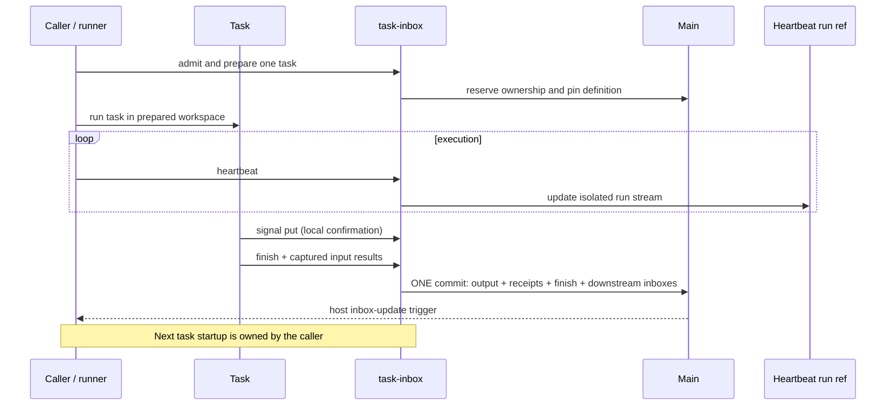

# Main inboxes and signal delivery (runtime 2.14)

Schema 11 stores messages at `<task-root>/io/inbox/messages/<message-id>.json`
on the authority branch, normally main. Task roots come from task definitions,
including indexed slug directories. Receipts stay in `<task-root>/io/receipts/`.
Messages are immutable; retain them to suppress repeated delivery.

A successful `run finish` saves business output, supplied input results, terminal
run state, slot release and all subscriber notifications in one CAS main commit.
Either that entire commit is accepted or none of it is. A conflicting notification
or output prevents completion and leaves the run owned for reconciliation. Retry
the original operation ID after a lost response. Unrelated concurrent main changes
are retried; task data uses ordinary three-way content merging and fails on conflict.
Generation/ownership fencing remains separate from content merging.



## Declared signals

An interface version 2 declares published IDs, types and optional validation.
It never names consumers or execution hosts. Version 1 declarations remain
compatible and descriptive while adopters upgrade.

```json
{
  "schema_version": 2,
  "inbox": ["signal-changed"],
  "signals": {
    "reads": [],
    "writes": [
      {"id": "data-a", "type": "example/data", "required": true},
      {"id": "data-b", "type": "example/data", "value_schema": "schemas/data.json"}
    ]
  },
  "readiness": "inbox"
}
```

Use lowercase IDs, as for all runtime identities. An optional output may contain
one `*` wildcard for task-owned dynamic artifact IDs. Subscription CLI commands
require an exact declared ID. Required outputs must have an exact ID and must be
confirmed through `signal put` during every successful run. ID/type mismatches,
unconfirmed file edits, or missing required outputs reject finish. Contracts and
optional schema files are pinned to the run's definition commit.

`value_schema` validates the signal's `value` (or `payload`) using an offline
subset: `type`, `required`, `properties`, boolean `additionalProperties`, `items`,
`enum`, and descriptive keywords. `$ref`, remote loading and other JSON Schema
features are unsupported. The schema file is relative to the task root.

`signal put` confirms the output in the prepared workspace; it does not push.
Revisions advance automatically when logical content changes. Envelope fields
`revision`, `observed_at`, `generated_at`, `emitted_at` and `run_id` do not count as
logical changes. Meaningful timestamps belong inside `value`/`payload` or another
business field such as `period_key`. Unchanged content retains the entire previous
record and revision. Repeat an identical put safely, or explicitly update a confirmation owned by
this same run. Edits that differ from both main and the saved confirmation are
preserved for reconciliation instead of being overwritten.

## Subscription conditions

```sh
task-inbox --operation-id subscribe-a signal subscribe --task task-a \
  --signal-id data-a --consumer task-b --on change --initial next
task-inbox --operation-id subscribe-b signal subscribe --task task-a \
  --signal-id data-b --consumer task-c --on run
```

- `change`: one notification per new revision. `initial=next` starts after the
  current revision; `initial=current` allows current state to be delivered by
  `signal sync` or the next source finish. Re-subscribing never moves the baseline.
- `run`: one notification per successful source run that explicitly confirms
  this output, even if its revision is unchanged. Only `initial=next` is allowed.
  A run that did not confirm this optional output creates no notification.

Both conditions publish on successful finish. Intermediate `run publish`, failure
and cancellation publish no signals or notifications. Business files can still be
explicitly published during a run. Run events cannot be reconstructed from latest
state by a later sync; they are committed with their source run's finish.

Version 2 notifications contain the fixed signal value, subscription identity,
trigger and revision, plus the source run ID for `run`. Their IDs are deterministic.
`read_notice` validates the embedded value and returns its hash; it does not
pair that frozen hash with a latest-main source file path. Consumers may instead choose to coalesce
and inspect latest main state. Legacy task-level routes and hint notifications are
retained on migration; they continue to converge to current state.

## Workspace and I/O

The runtime never periodically commits or pushes business files. Tasks may choose
worktree or executor-owned workspace mode, keep files dirty, or create their own
explicit commits/checkpoints. Heartbeat uses a separate Git index/ref and cannot
stage these files. `publish`/`finish` explicitly snapshot accepted files through Git
objects without changing the worker's HEAD or index. Main receives a single-parent
commit with the accepted tree; worker/heartbeat history is not merged into main.
Manual recovery remains necessary for lost unpublished local files. Explicit work
checkpoints remain the executor's responsibility.

Executor-owned workspaces may have pre-existing dirty files at preparation.
Those exact files are preserved and excluded from publication; changing them
requires reconciliation. Newly changed files must stay within the admitted task's
data/artifact boundary. Executor-owned directories are never automatically removed.
Owned temporary worktrees are removed only after exact output and termination
checks; unknown files or commits retain the workspace.

Use `run finish --input-results-file results.json` with an object mapping captured
message IDs to verified result objects, e.g. `{"request-1":{"status":"succeeded"}}`.
The Python `main_io.stage_results` API can defer verified results locally; default
successful finish accepts that frozen set atomically. Intermediate publication,
failed and cancelled finishes leave deferred results pending. Explicit finish
results can also report a verified failure. The statuses are `succeeded`, `failed`
and `superseded`. Completion is explicit;
finish never automatically acknowledges all pending messages. Late arrivals remain
pending for another caller. `io send`, `io emit` and `io complete` remain explicit
mid-run authority transactions for durable external-operation intents and results.
They do not snapshot other dirty files. Heartbeat keeps only a final checkpoint,
without its commit history on main. Lease-enabled recovery profiles additionally
renew their authority fence; those ownership operations are not business snapshots.

## Migration and host integration

1. Pause all producers and runners. Drain/reconcile every occupied slot and all
   legacy inbox writers, including external senders. A paused schedule alone does
   not prove this. Deploy 2.14 to every writer before resuming.
2. Update task declarations. Keep existing receipts/messages and forensic refs.
3. Run `task-inbox --operation-id main-inbox-cutover io migrate
   --confirm-writers-drained` (one shell command). Optional `--subscriptions-file`
   accepts an array of `{task_id, consumer, signal_id, on, initial}` specs and
   installs those routes in the same cutover commit. Import or validation errors
   leave main unchanged. Migration preserves legacy refs and completion receipts.
4. Verify schema 11, pending messages and the new host inbox watcher, then resume
   only authorized schedules. Older runtime versions reject schema 11.

The caller owns triggers, credentials, model selection and reconciliation.
`execute` accepts exactly one task. `--continue` and `--max-tasks` are removed.
A watcher should inspect durable pending work on inbox updates and slot release,
so an arrival during an occupied slot is retried after finish. A lost startup event
must remain recoverable through manual or independently scheduled reconciliation.
On GitHub, pushes made with standard `GITHUB_TOKEN` suppress subsequent push
workflows. Use a GitHub App token/PAT for task-data pushes, or provide an explicit
runner-owned dispatch/completion reconciliation mechanism. task-inbox never invokes
another task or contacts a host Actions API.
